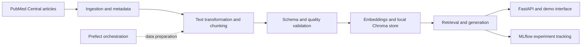

# PipelineForge · Biomedical RAG Assistant

An academic **medical question-answering chatbot grounded in PubMed Central articles**, developed by a team of **eight students across four Agile sprints**. The project combines corpus ingestion, transformation, data-quality checks, retrieval, generation, experiment tracking and an HTTP interface.

[Academic report](Rapport_et_ppt/Rapport_Academique_PipelineForge.pdf) · [Presentation](Rapport_et_ppt/PipelineForge_Soutenance_MLOps.pptx.pptx) · [API documentation](api/README.md) · [RAG evaluation](rag/Rapport_Evaluation_RAG.md)

## What to review

| Component | Purpose | Entry point |
| --- | --- | --- |
| Ingestion | Collect biomedical full text and metadata from PMC | [ingestion/collect_pmc.py](ingestion/collect_pmc.py) |
| Transformation | Convert source documents into structured chunks | [transformation/README.md](transformation/README.md) |
| Quality | Validate schema and transformed corpus | [quality/](quality/), [tests/README.md](tests/README.md) |
| Embeddings | Build searchable article representations | [embeddings/README.md](embeddings/README.md) |
| RAG | Retrieve context, generate sourced answers and track runs | [rag/README.md](rag/README.md) |
| API and UI | Expose question answering through FastAPI and a demo page | [api/README.md](api/README.md) |
| Orchestration | Run transformation, tests and validation with Prefect | [orchestration/README.md](orchestration/README.md) |
| Delivery | Container/service configuration and GitHub Actions CI | [docker-compose.yml](docker-compose.yml), [CI workflow](.github/workflows/ci.yml) |

## System overview



The retrieval module currently uses **Chroma**. The Compose stack also declares **Qdrant**, but that service should not be taken as evidence that the current retriever is connected to Qdrant.

## Corpus and evaluation

The Sprint 1 ingestion notes report **700 articles collected without duplicates**, with license metadata and variable document lengths. See the preserved [ingestion notes](#original-ingestion-notes) for source selection, collection details and reuse restrictions.

The RAG module documents a qualitative evaluation using eight questions. This is a small academic test, not a clinical validation or a measured general-purpose accuracy benchmark. Answers depend on retrieved sources and model behavior and should be checked against the cited articles.

## Running the project

Start with the component guides linked above. Local setup requires a generated vector store, compatible ML dependencies, access to the configured generation provider and an MLflow tracking server.

1. Review ingestion and transformation settings before downloading or rebuilding the corpus.
2. Generate and validate chunks using the transformation/quality modules.
3. Build the local store as described in [embeddings/README.md](embeddings/README.md).
4. Configure a local `.env` from [.env.example](.env.example), using your own provider key.
5. Follow the [RAG](rag/README.md) and [API](api/README.md) guides to test the chain and HTTP interface.

The Compose file exposes API port **8000**, Qdrant **6333** and MLflow **5000**. It is an integration configuration, not a verified one-command demo: the API guide records pending real-store integration tests and dependency/path alignment work. Review these notes before starting the full stack.

## Team and contribution

This is a collaborative project. **Marouane Daouki contributed the PMC ingestion work**, including article collection and metadata preparation; the overall deliverable is the team's biomedical RAG chatbot. Module READMEs and Git history document the other contributors and sprint responsibilities.

## License and scope

See [LICENSE](LICENSE) for the software license. Source articles retain their own licenses; those metadata and reuse restrictions remain relevant independently of the code license. This application is for academic exploration of biomedical literature and is not a clinical decision system.

## Original ingestion notes

<details>
<summary>Sprint 1 source collection notes</summary>

# pipelineforge-rag-assistant
# Ingestion — PipelineForge

Collecte automatique d'articles scientifiques biomedicaux depuis PubMed Central,
via le jeu de donnees public `pmc-oa-opendata` (remplace l'ancien service FTP/OA
de NCBI, retire le 24 aout 2026).

## Sources

- **API de recherche** : NCBI E-utilities (`esearch`, base de donnees `pmc`)
- **Contenu** : bucket S3 public `pmc-oa-opendata` (metadonnees JSON + texte
  integral), acces en HTTPS simple, aucune cle/compte AWS necessaire
- **Filtre applique** : `(open_access[filter] OR author_manuscript[filter])`
  — ne garde que les articles reellement recuperables via ce dataset

## Mots-cles utilises (Sprint 1, atelier de cadrage)

cancer treatment, infectious disease, clinical trial, drug efficacy, vaccine,
diabetes, cardiovascular disease, public health, machine learning diagnosis,
epidemiology

## Comment relancer la collecte

```powershell
python ingestion\collect_pmc.py
```

Parametres ajustables en haut du script : `KEYWORDS`, `PER_KEYWORD_MAX`,
`TARGET_TOTAL`.

## Resultat de la collecte (Sprint 1)

- **700 articles** collectes, aucun doublon
- Repartition des licences : CC BY (367), CC BY-NC-ND (178), CC BY-NC (151), TDM (4)
- Longueur des textes : mediane ~53 000 caracteres, max ~1,2 million
  caracteres (quelques documents atypiques, a surveiller lors du chunking)
- Le mot-cle `epidemiology` n'a rapporte aucun article : le volume cible
  (700) a ete atteint avant d'y arriver dans l'ordre de la liste

## A savoir avant d'utiliser ce corpus (Transformation / Qualite)

- **Les 4 articles "TDM"** ne sont pas de l'Open Access classique : ce sont
  des manuscrits d'auteur finances par le NIH, avec une licence plus
  restrictive que les licences CC.
- **La longueur des documents varie fortement** — le chunking ne doit pas
  supposer une taille homogene.

## Schema des donnees

Chaque article produit 2 fichiers dans `data/raw/` (non versionnes dans Git,
reproductibles via le script) : `PMC<id>.1.json` (metadonnees) et
`PMC<id>.1.txt` (texte integral, deja sectionne).

`data/raw/metadata_index.csv` (celui-ci reste versionne) recense tous les
articles : `pmcid`, `version`, `title`, `license`, `doi`, `char_count`,
`matched_keyword`.

## Pour la suite (Transformation — Imane Alouani)

Lire `metadata_index.csv` pour la liste des articles, puis charger le `.txt`
correspondant a chaque `pmcid`.
</details>
